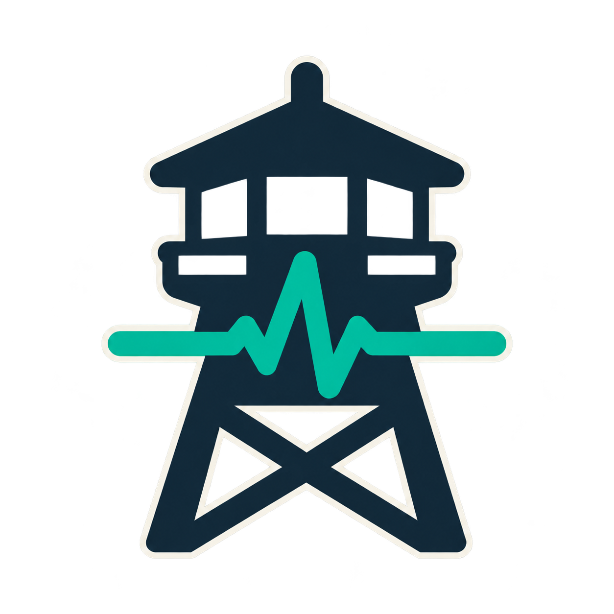
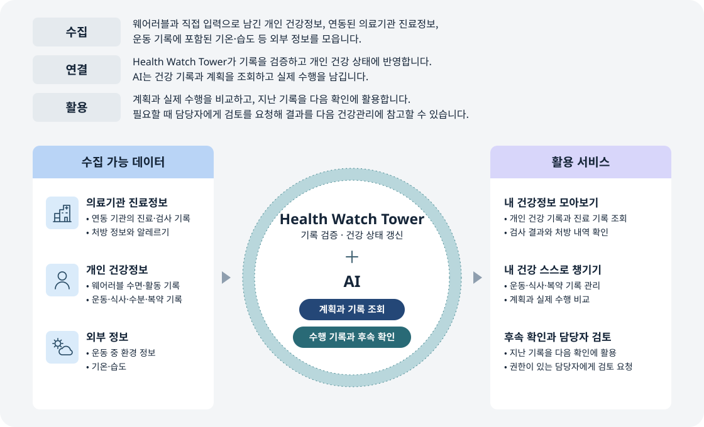
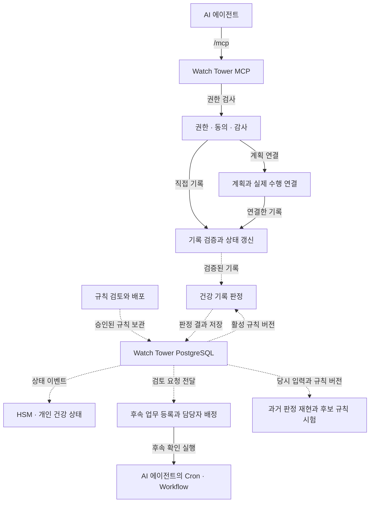

<p align="center">
  
</p>

<h1 align="center">Health Watch Tower</h1>

<p align="center"><strong>개인 건강관리 플랫폼</strong></p>

<p align="center">
  AI가 건강 계획을 조회하고 실제 수행을 기록해, 다음 확인이나 담당자 검토로 이어갑니다.
</p>

<p align="center">
  <a href="#로컬에서-실행"><strong>로컬에서 실행</strong></a> ·
  <a href="#ai-연결"><strong>AI 연결</strong></a> ·
  <a href="#사용-예시"><strong>사용 예시</strong></a> ·
  <a href="#작동-방식"><strong>작동 방식</strong></a>
</p>

## Overview

Health Watch Tower는 개인 건강정보, 의료기관 진료정보, 외부 정보를 한곳에 모아 AI가 일상 건강관리에 활용할 수 있도록 연결합니다.

[](docs/assets/health-watch-tower-overview.svg)

**예시** · 운동을 마치고 AI에 이렇게 말할 수 있어요.

> **나**　오늘 스쿼트 40kg으로 8회씩 2세트 했어. 기록해줘.
>
> **AI**　오늘 계획 3세트 중 수행한 2세트를 기록했어요. 다음 운동 전에 다시 확인할까요?

## Quick Start

### 로컬에서 실행

Docker Compose와 별도로 확보한 런타임 소스가 필요합니다. 먼저 [로컬 실행 준비](docs/local-setup.md#환경-설정)에 따라 환경을 설정한 뒤, 소스 루트에서 PowerShell로 기동합니다.

```powershell
docker compose --env-file target/avatar-docker.env -f docker-compose.avatar-mvp.yml up -d
curl.exe -f http://127.0.0.1:17842/healthz
```

`/healthz`가 HTTP 200을 반환하면 Health Watch Tower API가 준비된 상태입니다.

### AI 연결

로컬 **Watch Tower MCP** 주소는 `http://127.0.0.1:17842/mcp`입니다. AI는 이 인터페이스를 통해 건강 계획을 조회하고 수행을 기록합니다.

개인 기록을 사용하려면 [계정 연결, 동의 및 OpenFGA 관계](docs/local-setup.md#개인-기록-접근-권한)를 먼저 설정합니다. 오늘 운동 계획을 준비한 뒤 AI에 **“오늘 운동 계획 보여줘”**라고 요청하면 등록된 운동 종목과 목표 세트·횟수를 확인할 수 있습니다.

## 사용 예시

| 예시 | 해볼 수 있는 일 |
| --- | --- |
| [운동 계획과 실제 수행](example/workout-plan-and-actual.md) | 오늘 계획을 불러오고 수행 기록을 다음 점검이나 트레이너 검토로 연결합니다. |
| [기존 운동 기록 가져오기](example/workout-csv-import.md) | Strong·Hevy CSV를 미리 보고 가져온 뒤 운동 기록을 확인합니다. |
| [수면 기록 비교](example/sleep-review.md) | 수면 기록을 기간별로 비교하고 누락된 날짜를 확인합니다. |
| [식사 기록과 영양 확인](example/meal-and-nutrition.md) | 식사 기록을 확인해 저장하고, 하루 영양 합계와 담당자 검토를 살펴봅니다. |
| [수분 섭취 기록](example/water-intake.md) | 마신 물을 기록하고 오늘 기록된 양을 합산합니다. |
| [복약 확인](example/medication-confirmation.md) | 예정된 복약 기록을 조회하고 실제 응답을 남깁니다. |
| [웨어러블 활동 기록 확인](example/wearable-activity.md) | 연결된 기기의 걸음 수와 운동 세션을 살펴봅니다. |
| [개인 건강 상태 갱신과 후속 확인](example/health-state-follow-up.md) | 새 기록이 HSM에 반영되고 확인이나 검토로 이어지는 흐름을 살펴봅니다. |
| [낙상 이벤트 이후 안부 확인](example/fall-event-follow-up.md) | 연동 기기의 낙상 의심 이벤트 이후 사용자 상태를 확인하는 목표 시나리오입니다. |
| [여러 기록을 함께 보는 사전 확인](example/combined-signal-check-in.md) | 수면과 운동 기록을 함께 살펴 다음 계획을 확인하도록 알리는 목표 시나리오입니다. |
| [AI 접근 권한과 동의 철회](example/ai-access-and-consent.md) | 읽기 권한과 쓰기 권한이 요청 결과에 어떻게 반영되는지 확인합니다. |

## 작동 방식



실선은 현재 연결, 점선은 목표 설계의 연결입니다.

AI가 공통 `/mcp`에서 계획을 조회하고 실제 수행을 기록합니다. Watch Tower는 권한과 동의를 확인하고, 연결할 계획이 있으면 계획 ID와 버전을 기록에 남깁니다. 기기에서 들어온 관측이나 계획 없이 남긴 기록도 검증을 거칩니다. **HSM(Health State Machine)**은 확정된 상태 변경을 개인 건강 상태에 반영합니다.

**AI가 후속 확인을 진행하고 필요할 때 담당자 검토를 요청합니다.** Watch Tower는 검토 요청을 기록에 연결하고 현재 동의와 권한을 확인해 담당자를 배정합니다. 예약된 확인은 AI의 Cron이 시작하고 Workflow가 응답·미응답과 확인 기한을 관리합니다. 새로 확인한 건강 사실은 MCP를 통해 다시 기록합니다.

### 건강 기록을 확인하는 기준

앞으로는 검증을 마친 건강 기록을 미리 정한 기준에 따라 살펴봅니다. 그 결과를 개인 건강 상태에 반영하고, 추가 확인이 필요하면 담당자 검토로 연결합니다.

| 단계 | 작동 방식 |
| --- | --- |
| 규칙 배포 | 같은 입력으로 후보 규칙과 운영 규칙을 비교한 뒤 승인된 버전을 활성화합니다. 롤백할 때는 보관한 이전 버전을 다시 활성화합니다. |
| 운영 판정 | 평가를 시작할 때 규칙 버전과 입력 기록의 버전을 고정합니다. 판정 ID와 이유, 상태 이벤트, 검토 전달을 위한 outbox 항목을 PostgreSQL의 한 트랜잭션에 저장합니다. 같은 이벤트를 재시도하면 기존 판정 ID를 사용합니다. |
| 상태 갱신과 후속 확인 | 커밋된 상태 이벤트를 HSM에 반영합니다. 검토가 필요한 건은 같은 판정에서 중복 업무가 생기지 않도록 등록하고, 전달 직전에 동의와 권한을 확인합니다. 후속 확인은 AI의 Workflow에서 실행합니다. |
| 과거 재현과 후보 시험 | 당시 입력·기준 시각·엔진 빌드·규칙 버전으로 판정을 재현하거나, 같은 입력으로 후보 버전의 결과와 이유를 비교합니다. 두 평가 모두 운영 흐름과 격리된 환경에서 실행합니다. HSM 상태를 재구성할 때는 이미 저장한 상태 이벤트를 사용합니다. |

## 데이터와 권한

- AI는 사용자가 허용한 범위에서 기록을 읽거나 남길 수 있습니다.
- AI가 제출한 검토 요청은 저장된 기록에 연결되며, Health Watch Tower는 현재 권한을 확인해 담당자를 배정합니다.
- 동의를 철회하면 해당 범위에서 AI가 새로 요청하는 접근이 차단됩니다. [AI 접근 권한과 동의 철회](example/ai-access-and-consent.md)

## Run the server

See the [runtime setup](docs/runtime.md) for the standalone MCP server and PostgreSQL.
