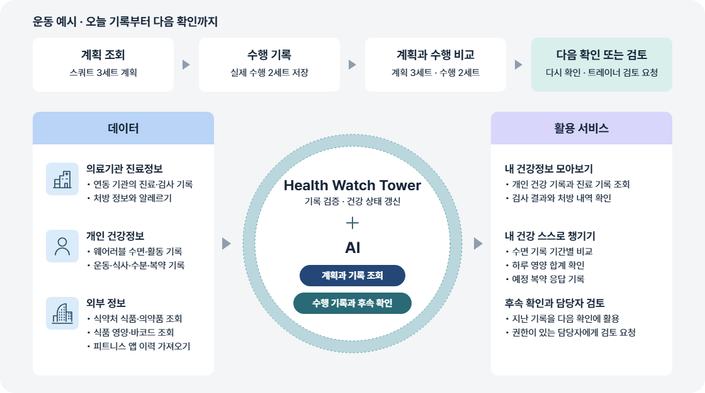
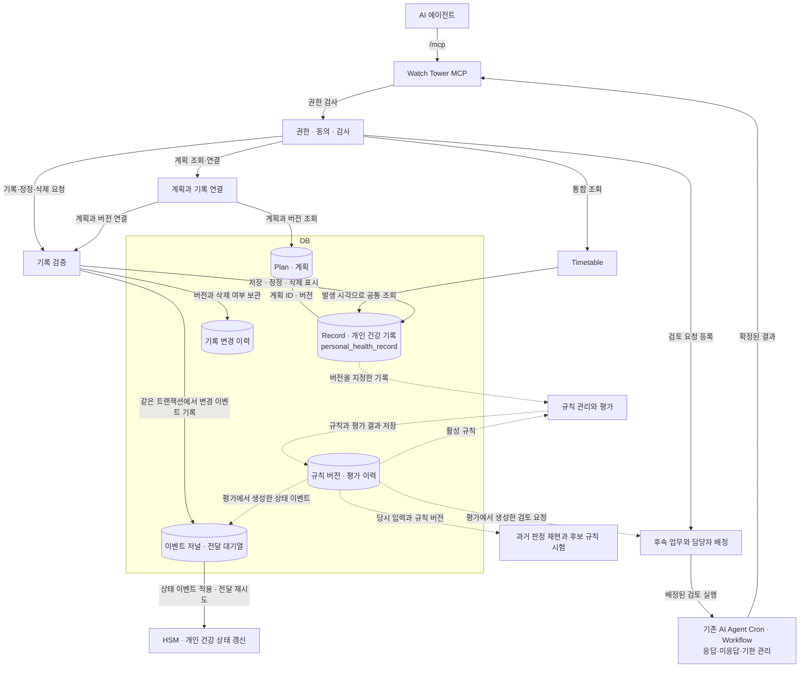

<p align="center">
  
</p>

<h1 align="center">Health Watch Tower</h1>

<p align="center"><strong>개인 건강관리 플랫폼</strong></p>

<p align="center">
  AI가 건강 계획을 조회하고 실제 수행을 기록해, 다음 확인이나 담당자 검토로 이어갑니다.
</p>

<p align="center">
  <a href="#로컬에서-실행"><strong>로컬에서 실행</strong></a> ·
  <a href="#ai-연결"><strong>AI 연결</strong></a> ·
  <a href="#데이터-카탈로그"><strong>데이터 카탈로그</strong></a> ·
  <a href="#사용-예시"><strong>사용 예시</strong></a> ·
  <a href="#작동-방식"><strong>작동 방식</strong></a>
</p>

## Overview

Health Watch Tower는 개인 건강정보, 의료기관 진료정보, 외부 정보를 한곳에 모아 AI가 일상 건강관리에 활용할 수 있도록 연결합니다.

외부 정보에는 식약처의 식품 영양성분과 의약품 정보, Open Food Facts·USDA의 식품 데이터, Strong·Hevy에서 내보낸 운동 이력이 포함됩니다.



**예시** · 운동을 마치고 AI에 이렇게 말할 수 있어요.

> **나**　오늘 스쿼트 40kg으로 8회씩 2세트 했어. 기록해줘.
>
> **AI**　오늘 계획 3세트 중 수행한 2세트를 기록했어요. 다음 운동 전에 다시 확인할까요?

## Quick Start

### 로컬에서 실행

Docker Compose와 별도로 확보한 런타임 소스가 필요합니다. 먼저 [로컬 실행 준비](docs/local-setup.md#환경-설정)에 따라 환경을 설정한 뒤, 소스 루트에서 PowerShell로 기동합니다.

```powershell
docker compose --env-file target/avatar-docker.env -f docker-compose.avatar-mvp.yml up -d
curl.exe -f http://127.0.0.1:17842/healthz
```

`/healthz`가 HTTP 200을 반환하면 Health Watch Tower API가 준비된 상태입니다.

### AI 연결

로컬 **Watch Tower MCP** 주소는 `http://127.0.0.1:17842/mcp`입니다. AI 에이전트는 이 인터페이스로 건강 계획을 조회하고, 수행을 기록하고, Timetable에서 개인 건강 기록을 함께 봅니다.

개인 기록을 사용하려면 [계정 연결, 동의 및 OpenFGA 관계](docs/local-setup.md#개인-기록-접근-권한)를 먼저 설정합니다. 오늘 운동 계획을 준비한 뒤 AI에 **“오늘 운동 계획 보여줘”**라고 요청하면 등록된 운동 종목과 목표 세트·횟수를 확인할 수 있습니다.

## 사용 예시

| 예시 | 해볼 수 있는 일 |
| --- | --- |
| [운동 계획과 실제 수행](example/workout-plan-and-actual.md) | 오늘 계획을 불러오고 수행 기록을 다음 점검이나 트레이너 검토로 연결합니다. |
| [기존 운동 기록 가져오기](example/workout-csv-import.md) | Strong·Hevy CSV를 미리 보고 가져온 뒤 운동 기록을 확인합니다. |
| [수면 기록 비교](example/sleep-review.md) | 수면 기록을 기간별로 비교하고 누락된 날짜를 확인합니다. |
| [식사 기록과 영양 확인](example/meal-and-nutrition.md) | 식사 기록을 확인해 저장하고, 하루 영양 합계와 담당자 검토를 살펴봅니다. |
| [수분 섭취 기록](example/water-intake.md) | 마신 물을 기록하고 오늘 기록된 양을 합산합니다. |
| [복약 확인](example/medication-confirmation.md) | 예정된 복약 기록을 조회하고 실제 응답을 남깁니다. |
| [웨어러블 활동 기록 확인](example/wearable-activity.md) | 연결된 기기의 걸음 수와 운동 세션을 살펴봅니다. |
| [개인 건강 상태 갱신과 후속 확인](example/health-state-follow-up.md) | 새 기록이 HSM에 반영되고 확인이나 검토로 이어지는 흐름을 살펴봅니다. |
| [낙상 이벤트 이후 안부 확인](example/fall-event-follow-up.md) | 연동 기기의 낙상 의심 이벤트 이후 사용자 상태를 확인하는 목표 시나리오입니다. |
| [여러 기록을 함께 보는 사전 확인](example/combined-signal-check-in.md) | 수면과 운동 기록을 함께 살펴 다음 계획을 확인하도록 알리는 목표 시나리오입니다. |
| [AI 접근 권한과 동의 철회](example/ai-access-and-consent.md) | 읽기 권한과 쓰기 권한이 요청 결과에 어떻게 반영되는지 확인합니다. |

## 작동 방식



실선은 런타임 코드에 연결된 경로를, 점선은 규칙 평가와 자동 후속 확인의 목표 설계를 나타냅니다.

Watch Tower는 권한과 동의를 확인한 뒤 운동·식사·복약·수면 원본을 `watch_tower.personal_health_record`에 저장합니다. 계획이 있는 수행 기록은 해당 계획의 ID와 버전에 연결합니다. **Timetable**(`get_personal_health_timeline`)은 공통 원본을 발생 시각 순서로 읽고 연결된 계획과 기록 유형별 정보를 함께 보여줍니다. 삭제 표시된 원본은 조회 결과에서 제외합니다.

정정·삭제는 원본의 버전과 변경 이력에 남습니다. 변경 경로에 따라 이벤트를 같은 트랜잭션에서 저널에 기록하거나 전달 대기열에 저장합니다. Watch Tower는 대기열에 저장된 이벤트의 전달을 재시도할 수 있습니다. **HSM(Health State Machine)**은 이벤트를 적용해 개인 건강 상태를 갱신합니다.

기존 **AI Agent Workflow**가 확인 응답·미응답과 기한을 실행에 남깁니다. 예약된 확인은 Cron이 시작하고, 확정된 기록은 MCP로 공통 원본에 저장합니다. 담당자 검토가 필요하면 Watch Tower가 검토 요청을 기록에 연결하고 현재 동의와 권한을 확인해 배정한 뒤 Workflow로 실행합니다.

### 규칙 관리와 평가

앞으로는 검증을 마친 건강 기록을 미리 정한 기준에 따라 살펴봅니다. 그 결과를 개인 건강 상태에 반영하고, 추가 확인이 필요하면 담당자 검토로 연결합니다.

| 단계 | 작동 방식 |
| --- | --- |
| 규칙 배포 | 같은 입력으로 후보 규칙과 운영 규칙을 비교한 뒤 승인된 버전을 활성화합니다. 롤백할 때는 보관한 이전 버전을 다시 활성화합니다. |
| 운영 판정 | 평가를 시작할 때 규칙 버전과 입력 기록의 버전을 고정합니다. 판정 ID와 이유, 상태 이벤트, 검토 전달을 위한 outbox 항목을 PostgreSQL의 한 트랜잭션에 저장합니다. 같은 이벤트를 재시도하면 기존 판정 ID를 사용합니다. |
| 상태 갱신과 후속 확인 | 커밋된 상태 이벤트를 HSM에 반영합니다. 검토가 필요한 건은 같은 판정에서 중복 업무가 생기지 않도록 등록하고, 전달 직전에 동의와 권한을 확인합니다. 후속 확인은 AI의 Workflow에서 실행합니다. |
| 과거 재현과 후보 시험 | 당시 입력·기준 시각·엔진 빌드·규칙 버전으로 판정을 재현하거나, 같은 입력으로 후보 버전의 결과와 이유를 비교합니다. 두 평가 모두 운영 흐름과 격리된 환경에서 실행합니다. HSM 상태를 재구성할 때는 이미 저장한 상태 이벤트를 사용합니다. |

## 데이터와 권한

- AI는 사용자가 허용한 범위에서 기록을 읽거나 남길 수 있습니다.
- AI가 제출한 검토 요청은 저장된 기록에 연결되며, Health Watch Tower는 현재 권한을 확인해 담당자를 배정합니다.
- 동의를 철회하면 해당 범위에서 AI가 새로 요청하는 접근이 차단됩니다. [AI 접근 권한과 동의 철회](example/ai-access-and-consent.md)

## 데이터 카탈로그

[내가 남긴 기록](#내가-남긴-기록) · [기기에서 가져오는 데이터](#기기에서-가져오는-데이터) · [클라우드 연결](#클라우드-연결) · [파일 가져오기](#파일-가져오기) · [의료기관 진료정보](#의료기관-진료정보) · [식품과 의약품 참고 데이터](#식품과-의약품-참고-데이터)

아래 표는 구현된 수집·조회 경로를 기준으로 합니다. 기기·계정·동의 범위에 따라 가져올 수 있는 데이터가 달라집니다. 공급자별 운영 계정과 실기기 연동 검증 범위도 다릅니다.

### 내가 남긴 기록

| 데이터 | 기록하는 항목 |
| --- | --- |
| 운동 계획과 수행 | 종목, 목표 세트·반복·중량, 실제 수행한 세트·반복·중량, 연결된 계획 항목 |
| 식사와 영양 | 음식명, 섭취량, 열량, 탄수화물·단백질·지방, 하루 섭취 합계 |
| 수분 | 마신 양과 시각, 하루 섭취 합계 |
| 복약 | 예정된 복약과 실제로 복용했는지 또는 건너뛰었는지에 대한 응답 |

### 기기에서 가져오는 데이터

| 출처 | 수집하는 데이터 | 연결 조건 |
| --- | --- | --- |
| **Apple HealthKit** | 걸음·거리·고도·에너지, 보행·러닝·사이클·수영·잠수·설상 운동·휠체어 지표, 운동 강도와 GPS 경로, 수면 단계·호흡 방해 기록, 심박·HRV·심박 회복·VO₂ Max, 산소포화도·폐기능, 체성분·혈압·혈당·체온·혈중알코올, 수분·영양소, 명상, 기기가 기록한 소음·일광·자외선 노출 | iPhone·Apple Watch에서 읽기 허용 |
| **Android Health Connect** | 걸음, 거리, 에너지, 층 수·고도 변화, 활동 강도, 운동·세트·경로·속도·파워·케이던스, 휠체어 활동, 수면, 심박·HRV·호흡·산소포화도·VO₂ Max, 체성분·혈당·혈압·체온·피부 온도, 기초대사량, 수분·영양소, 명상 | 호환 Android·동기화 앱과 항목별 읽기 동의 |
| **Samsung Health Data SDK** | 걸음·일일 활동·목표, 운동·GPS 경로, 에너지 점수, 수면 단계·점수, 심박·산소포화도, 체성분·혈압·혈당·체온·피부 온도, 식단·수분, 지원 기기의 심장 리듬 알림·수면 무호흡 기록 | SDK 포함 앱과 항목별 동의. 리듬·무호흡 데이터는 SDK 1.1과 지원 기기 필요 |

### 클라우드 연결

| 출처 | 수집하는 데이터 | 연결 조건 |
| --- | --- | --- |
| **Google Health** · Fitbit, Pixel Watch | 걸음·거리·에너지·층 수·고도, 활동 강도·좌식 시간, 심박과 심박 구간·HRV·산소포화도, 수면 단계·호흡, 운동·수영 구간·TCX 경로, VO₂ Max, 키·체중·체지방·혈당·체온. 별도 권한으로 ECG·리듬 알림과 식사·수분 | 승인된 Google Health 프로젝트와 OAuth |
| **Garmin Connect Personal** | 운동·FIT 원본, 심박, 수면·단계, 공급자 일일 요약, 주기·증상과 관련 기록 | 개인 API 키 |
| **Garmin Health** · 사업자 연동 | 일일·구간 활동, Move IQ, 운동 상세·FIT, 수면·낮잠, 심박·야간 HRV·호흡수·산소포화도, 스트레스·Body Battery, 체성분·혈압·VO₂ Max·피부 온도 편차, 지원되는 주기 기록 | Garmin 파트너 승인과 사용자 OAuth |
| **Oura** | 수면 단계·심박·HRV, 운동, 활동·수면·준비도·스트레스·회복탄력성·취침 권장 시간, 휴식 모드, 권한에 따른 산소포화도·호흡 교란·심혈관 나이·VO₂ Max·가이드 세션 | Oura OAuth와 항목별 동의 |
| **WHOOP** | 수면·운동 상세, 사이클·회복, 걸음·소비 에너지, 신체 측정값 | WHOOP OAuth |
| **Polar** | 운동 상세·심박 구간·훈련 부하·FIT, 수면·Nightly Recharge·SleepWise, 일일 활동·연속 심박, Elixir 체온·피부 온도·접촉·ECG·산소포화도, 신체·훈련 프로필 | Polar Flow와 AccessLink OAuth |
| **Suunto** | 운동·FIT, 수면·낮잠, 일일 걸음·활동 에너지, 심박·HRV·산소포화도, 회복 기록 | OAuth와 개발자 구독 키 |
| **COROS** | 운동·멀티스포츠·FIT, 일일 활동, 안정 시 및 수면 심박, HRV, 권한이 있는 수면·낮잠 상세 | 파트너 승인과 사용자 토큰 |
| **Withings** | 수면 단계·코골이·호흡·HRV 시계열, 운동·일일 활동, 체성분·혈압·혈당·체온·산소포화도, ECG 파형, 맥파 속도·혈관 나이·VO₂ Max·기초대사량, U‑Scan 소변 지표 | Withings OAuth와 측정 권한 |
| **Ultrahuman** | 수면 세션·단계·효율, 일일 활동, 시각별 심박·HRV·온도·걸음, 링 일일 지표 | 파트너 OAuth |
| **Sensor Bio** | 수면·단계, 심박·HRV·산소포화도·호흡수, 회복 상세, 걸음·거리·열량과 일일 점수, 운동 | 데이터가 있는 계정과 OAuth |
| **Strava** | 운동 세션 | 활동 읽기 권한 |
| **Hevy** | 운동·세트·반복·중량 | Hevy API 키 |
| **Liftosaur** | 운동 날짜·종목, 원본 Liftoscript, 지원되는 기본 세트 기록 | Liftosaur API 키 |
| **Intervals.icu** | 운동 세션·FIT, 걸음·체중·안정 시 심박·HRV·수면·회복·훈련 부하 | OAuth 또는 개인 시험용 API 키 |

### 파일 가져오기

| 출처 | 가져오는 데이터 | 형식 |
| --- | --- | --- |
| **Apple 건강 내보내기** | 활동·심박·수면·운동·체성분·생체 지표·영양·수분, 운동 원본 통계와 연결된 GPS 경로 | `export.xml` 또는 ZIP. GPX 경로는 ZIP에 포함된 경우 |
| **Strong** | 기존 운동, 종목, 세트·반복·중량 | Strong CSV |
| **Hevy** | 기존 운동, 종목, 세트·반복·중량 | Hevy CSV |

지원 공급자의 **FIT**에는 세션·랩·구간·수영 길이, 심박·HRV·속도·파워·GPS, 세트·센서·이벤트 등이 포함될 수 있습니다. [운동 CSV 가져오기 예시](example/workout-csv-import.md)

### 의료기관 진료정보

| 출처 | 가져오는 데이터 | 연결 조건 |
| --- | --- | --- |
| **연결한 의료기관 데이터 제공자** | 환자 연결 정보, 진단·상태, 검사·관찰 결과, 알레르기·불내성, 처방 요청 | 환자 연결 확인과 쓰기 동의, 지원하는 FHIR R4 형식 및 KR Core 프로필 설정 |

의료기관 데이터 가져오기 경로가 구현돼 있습니다. 실제 의료기관 계정 연동은 검증 전입니다.

### 식품과 의약품 참고 데이터

| 출처 | 조회하는 데이터 | 조회 방법 |
| --- | --- | --- |
| **식품의약품안전처 식품영양성분 데이터** | 국내 식품명, 기준량, 열량과 영양성분 | 식품명 검색 · 공공데이터포털 API 키 |
| **식품의약품안전처 e약은요** | 제품명, 제조사, 효능·용법, 주의사항·상호작용·이상반응 등 공개 제품 정보 | 제품명 검색 · 공공데이터포털 API 키 |
| **Open Food Facts** | 포장식품명, 바코드와 공급자가 제공한 영양성분 | 바코드 검색 |
| **USDA FoodData Central** | 식품명, 기준량과 영양소 | 식품명 검색 · USDA API 키 |

## Run the server

See the [runtime setup](docs/runtime.md) for the standalone MCP server and PostgreSQL.
