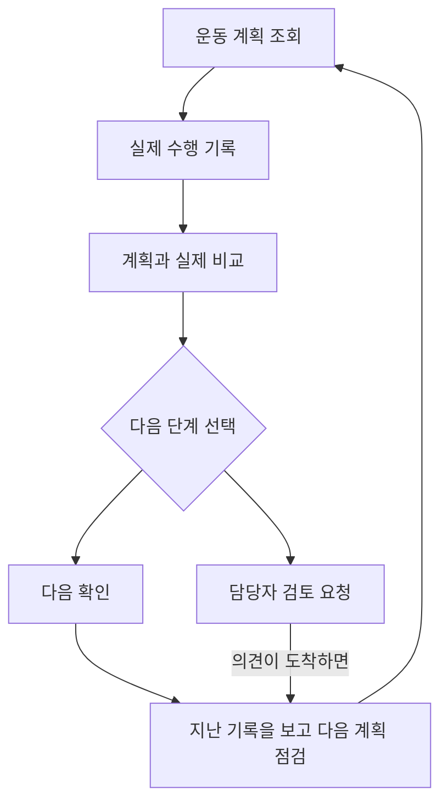

# 운동 계획과 실제 수행

운동 계획 3세트와 실제 수행 2세트를 비교하는 가상 예시입니다.

> **나**　오늘 운동 계획 보여줘.
>
> **AI**　오늘은 바벨 스쿼트 40kg으로 8회씩 3세트예요.
>
> **나**　바벨 스쿼트 40kg으로 8회씩 2세트 했어. 오늘 수행으로 남겨줘.
>
> **AI**　계획 3세트 중 2세트를 실제 수행으로 기록해 연결했어요. 다음 운동 때 이 기록을 다시 볼까요, 아니면 트레이너에게 검토를 요청할까요?

저장된 세트 중 연결 조건을 충족하는 기록을 운동 계획의 해당 항목에 연결할 수 있습니다. **내가 다시 확인하기로 하면** AI가 다음 점검 때 지난 수행을 불러옵니다. **검토를 요청하면** AI가 MCP로 검토 요청을 제출하고, Health Watch Tower가 해당 기록에 요청을 연결해 권한이 있는 담당자를 배정합니다. 담당자의 의견이 도착하면 지난 기록과 함께 참고하고, 다음 계획을 어떻게 조정할지는 내가 결정합니다.

[예시 목록](README.md)
